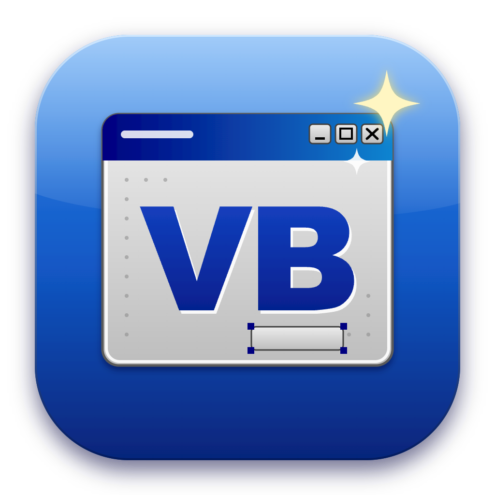
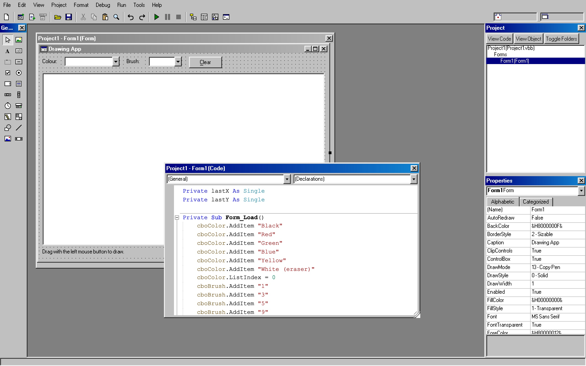
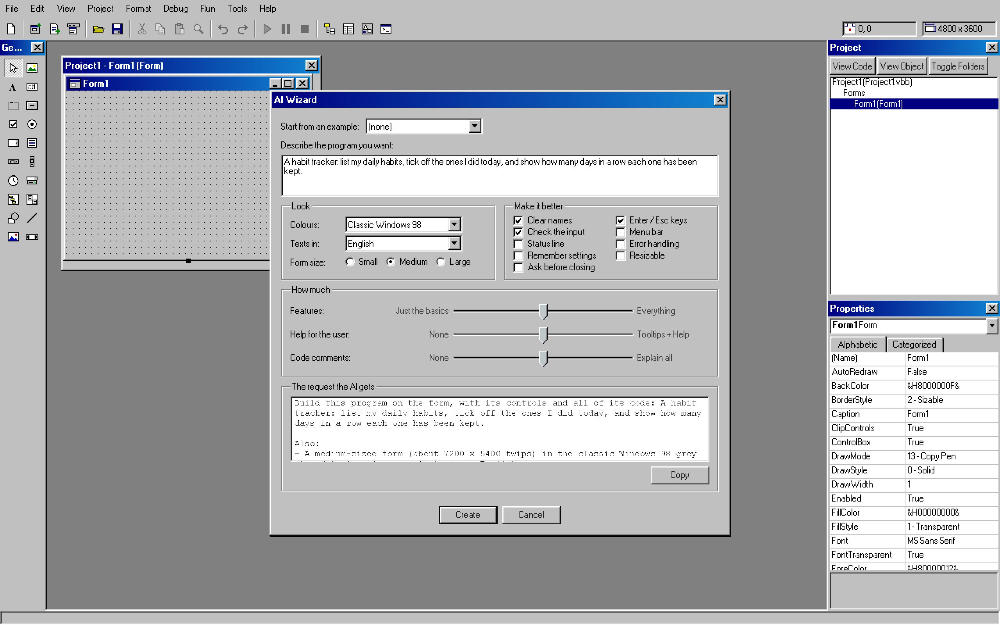
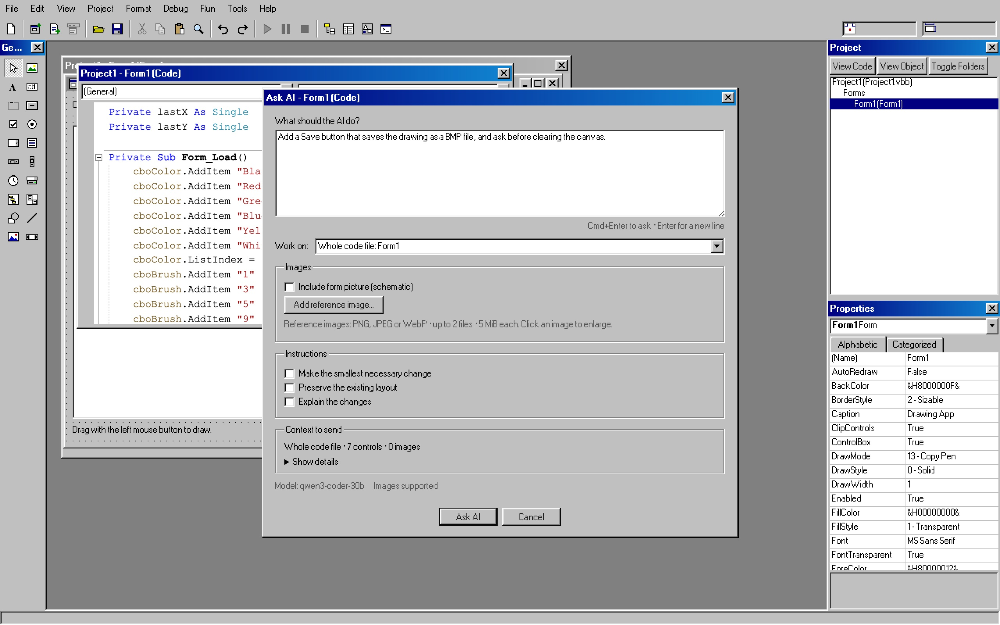

# VibeBasic

A Visual Basic 6 clone for macOS, Windows and Linux, with the authentic Windows 98 look and a built-in AI assistant that connects to OpenAI-compatible servers, including your own local model.



Design forms, write VB6 code and run it, in the Windows 98 look you remember.

## What it does

- **New and recent projects:** the startup chooser offers Standard EXE, MDI Application, Sub Main, Data Project and AI Wizard, plus Existing and Recent tabs. It also includes runnable Text Editor (plain-text files, File/Edit menus and a status line), Drawing App (colours, brush sizes and a canvas) and Serial Terminal (port, baud rate and text send/receive) presets with editable VB code. File > New Project opens it again; recently opened and saved projects also appear in the File menu.
- **Form designer:** drag controls onto a form, set their properties and double-click to write event code.
- **Menus:** Tools > Menu Editor (Ctrl+E) builds a form's menus as in VB6: `&` access keys, separators, submenus, Checked, Enabled and Visible, Shortcut keys, menu control arrays (`Load mnuMRU(i)` for a recent-files list) and `PopupMenu` for context menus. Each form window draws its own Win98 menu bar under its title bar, on every system (on macOS a program's menus never go into the menu bar at the top of the screen). On macOS a Ctrl shortcut also answers to Cmd, except Cmd+C, X, V, A, Z, W and Q, which stay with the Mac.
- **MDI:** Project > Add MDI Form makes the project's MDI form (the AppWorkspace grey; it holds aligned controls such as a Toolbar, a StatusBar or a PictureBox with Align, and invisible ones). Forms with `MDIChild = True` open inside it as Win98 child windows that move, resize, minimize and maximize within it ("MDIForm1 - [Form2]"); `Arrange`, `ActiveForm`, the Window list menu and merged child menus work as in VB6, and `Dim f As New Form2: f.Show` opens another instance of a form.
- **The VB6 language:** subs, functions, control arrays, `On Error`, `MsgBox`, `InputBox` and the familiar run-time error dialog. It also covers class modules (`Property Get/Let/Set`, `Event`/`RaiseEvent`/`WithEvents`, `Implements`), file I/O (`Open`, `Print #`, `Line Input`, `Get`/`Put`, `Dir`…), `SaveSetting`/`GetSetting`, `TypeOf`, named arguments, `Option Base`/`Compare`, `GoSub`, `#If`, the financial functions, `CreateObject` with ADO, `Scripting.Dictionary` and `FileSystemObject`, and VB6's own number and date rules.
- **Graphics and printing:** `Print`, `Line`, `Circle`, `PSet`, `PaintPicture`, `ScaleMode`, `AutoRedraw` and the `Paint` event on forms and PictureBoxes; the `Printer` object and the `Printers` collection print through a print preview and the system's print dialog (on macOS also Save as PDF).
- **Forms at run time:** `MousePointer` (the hourglass), the `Validate` event with `CausesValidation`, Alt+letter access keys, drag and drop (`DragDrop`/`DragOver`, OLE drag and drop with `DataObject`, and files dropped from Finder or Explorer), `Me.Controls`, `Forms`, `Clipboard` and `Screen`.
- **Code window:** Visual Studio-style colours (or classic VB6), folding of procedures and blocks (Edit > Outlining, Ctrl+M), indentation guides, procedure separators, matching `If`/`End If` highlighting, and automatic `End` lines.
- **Run and debug:** F5 runs the program in real windows. Breakpoints (F9), stepping (F8), the Immediate, Locals, Watch and Call Stack windows, data tips and Set Next Statement work as in VB6. Programs can start in `Sub Main` and read `Command$`.
- **Open VB6 projects:** File > Open Project reads `.vbp` projects with their `.frm`, `.frx`, `.bas` and `.cls` files, and shows a report of anything VibeBasic cannot use.
- **Make app:** File > Make builds a standalone program from your project, with its icon and the version information from Project Properties > Make. On macOS it is an `.app` that also opens the file types you list. On Windows, Make writes a single `<Name>.exe` (the project's icon and version information in its resources; it runs on Windows 10 and 11, which have the WebView2 runtime). File types are not registered there: Open With passes the file to `Command$`. On Linux it writes the `<Name>` executable with a `<Name>.desktop` launcher and `<Name>.png` icon next to it (it needs WebKitGTK 4.1, as VibeBasic does). Make only replaces a program it made itself.
- **Controls:** 59 control types across the built-in controls and 22 optional component libraries. A new project's toolbox starts with 19 built-in controls and Pointer. Enable the others under **Project > Components (Ctrl+T)**, or right-click the toolbox and choose Components; the selection is saved with each project:
  - Common Controls: TreeView, ListView, Toolbar, StatusBar, ImageList, ImageCombo, CoolBar (bands host other controls), DTPicker, FlatScrollBar, Animation (GIF, APNG, WebP and MP4 instead of AVI) and others, plus the Access-style Calendar (MSCAL).
  - Media and data: MSFlexGrid, MSChart, RichTextBox, MaskedEdit, MMControl and MediaPlayer.
  - Networking: WebBrowser, Inet and Winsock.
  - Serial ports and system information: MSComm (for an Arduino or a 3D printer over USB) and SysInfo. `CommPort` n opens COMn on Windows (as in VB6), the n-th `/dev/cu.*` device on macOS and the n-th `/dev/ttyUSB*` or `/dev/ttyACM*` device on Linux; the extra property `PortName` takes the port itself, e.g. `MSComm1.PortName = "/dev/cu.usbmodem1101"` or `"COM5"`.
  - Databases: the Data control, the ADO Data Control, DataGrid, DataList and DataCombo, with data binding. They use SQLite files (`.db`) instead of Jet `.mdb` files.
  - Sheridan 3D controls: SSPanel (with the flood bar), SSFrame, SSCommand, SSCheck, SSOption and SSRibbon.
  - Microsoft Agent, with characters of its own.
- **AI assistant:** connects to any OpenAI-compatible server, such as Ollama or vLLM.
  - **AI Wizard** under Tools or File > New Project builds a new program from your description. Pick an example, colours, language, form size and improvements, then review the request before creating it. You can explore the wizard before setting up an AI server.
  - Ask AI (Ctrl+I) writes code in the code window, or lays out controls in the form designer.
  - The Ask AI dialog shows the context to send. Choose selected code, the current procedure or the whole code file; optionally ask for a minimal change, preserve the layout or request an explanation. Include a schematic of the current form from either the designer or its code window, and attach up to two reference images (PNG, JPEG or WebP, at most 5 MiB each). Thumbnails and remove buttons let you review the attachments before sending. These choices do not change the global AI preferences; if a server omits images, the answer or proposal shows a warning.
  - **Ask AI** in the error dialog suggests a fix for the line that failed.
  - Every suggestion is shown as a preview. You can refine it with **Change...**, and it is applied as one undo step.
  - With a vision model, the AI sees a picture of your form. A layout check catches overlapping controls and cut-off captions, and the AI places controls relative to each other ("below Text1", "arrange as a row").
  - Generated code is checked before you see it: syntax, event signatures, missing procedures and wrong properties. Problems go back to the model once.
  - Questions get plain answers. Tools > AI Log shows each request's model, token counts, timing and outcome.



The **AI Wizard** turns a description into a new program; the request it will send updates as you choose.



**Ask AI** changes the code or form you are working on, and shows exactly what it will send.

## Download

Get the files from the [latest release](https://github.com/Stigern/VibeBasic/releases/latest) (X.Y.Z is the version):

| System | File | |
|---|---|---|
| macOS 12 or later, Apple Silicon | `VibeBasic-X.Y.Z-macos-arm64.zip` | Unzip and move VibeBasic.app to Applications. |
| Windows 10 or 11 (x64) | `VibeBasic-X.Y.Z-windows-x64-setup.exe` | The installer: Start menu entry and uninstaller. |
| | `VibeBasic-X.Y.Z-windows-x64.zip` | Portable: `VibeBasic.exe` alone, nothing installed. |
| Linux x64 (Debian, Ubuntu…) | `VibeBasic-X.Y.Z-linux-x64.deb` | `sudo apt install ./VibeBasic-X.Y.Z-linux-x64.deb` installs it with its dependencies. |
| Linux x64 (other distributions) | `VibeBasic-X.Y.Z-linux-x64.AppImage` | `chmod +x` it and run it. |

The apps are not signed by Apple or Microsoft, so the first start needs one extra step:

- **macOS:** right-click VibeBasic.app and choose **Open**, then **Open** again (on macOS 15 or later: try to open it once, then click **Open Anyway** under System Settings > Privacy & Security).
- **Windows:** if SmartScreen says "Windows protected your PC", click **More info**, then **Run anyway**. VibeBasic uses the Microsoft Edge WebView2 runtime, which Windows 10 and 11 have; the installer fetches it when it is missing.
- **Linux:** VibeBasic needs WebKitGTK 4.1 (the .deb pulls it in). The AppImage brings its own, but the programs you make with it use the system's: `sudo apt install libwebkit2gtk-4.1-0` on Debian and Ubuntu, `sudo dnf install webkit2gtk4.1` on Fedora. Debian 12, Ubuntu 22.04 or newer.

## Build

Requires Node.js, Rust and the Tauri 2 prerequisites.

```bash
npm install
npm run tauri dev      # run the IDE
npm run build:app      # build VibeBasic.app (scripts/build-app.sh runs tauri build)
npm test               # run the tests
```

On Windows and Linux, build with `npx tauri build --bundles nsis` or `npx tauri build --bundles deb,appimage` (tauri.conf.json lists only the macOS bundle). The release files are built by GitHub Actions (`.github/workflows/release.yml`) for each version tag; CI (`ci.yml`) runs the type check and the tests on all three systems.

GitHub is the source of truth: `main` holds the current source, and version tags identify released source. Publish a release by pushing its version tag after the version files and changelog are committed to `main`. GitHub Actions runs the tests and builds every download from that tag; reruns replace all release assets with those builds. Local builds are for development and testing.

To retry a release after a runner or package-mirror failure, run the Release workflow manually with the existing tag. Choose `linux` to rebuild only the Linux downloads, or `all` for every platform. Both the source and release notes are read from that tag; existing downloads for other platforms are kept.

### Code signing (macOS)

The signing identity is not in the repository. To sign your builds, create a file `.env.local` next to `package.json` (it is git-ignored) with your own identity:

```bash
APPLE_SIGNING_IDENTITY="Apple Development: Your Name (TEAMID)"
```

`security find-identity -v -p codesigning` lists the identities on your Mac. `npm run build:app` loads `.env.local`, and the Tauri bundler reads `APPLE_SIGNING_IDENTITY` from the environment. Sign every build with the same identity, or macOS asks again for permissions such as Local Network access (Winsock). Without an identity the app is built unsigned.

## AI setup

In the desktop app, **Tools > Options > AI > Search LAN...** finds AI servers on this computer, your local network or Tailscale. Select the networks/devices and ports to check, then press Start. Choose a result and press Use to fill the server URL and model; press OK in Options to keep them. The search shows each server's kind, models and response time, supports Stop/Close, and remembers your ports and five recent server URLs.

For **Tailscale**, connect its desktop client and tick **Include Tailscale peers**. VibeBasic reads the local client's known online IPv4 peers and lists them individually; select the devices to check. Untick LAN networks to search only Tailscale. The full Tailscale address range is never swept. The AI server must listen on its Tailscale address or all interfaces, and your tailnet's access policy must allow the chosen port. Peer connections allow two seconds for direct or relayed connections. If Tailscale is missing or disconnected, the dialog explains how to reconnect and LAN search remains available.

The default ports are 11434 (Ollama), 1234 (LM Studio), 8000 (vLLM) and 8080 (llama.cpp). LAN discovery checks selected private IPv4 networks, capped to /24; link-local networks are optional. LAN and Tailscale discovery together are capped to 1,024 hosts, plus localhost. Merely opening the dialog sends no probes. Your API key is excluded from discovery unless you select **Use API key when searching**. A server must listen on the relevant network address and allow the chosen port through its firewall to be found. Search LAN requires the macOS, Windows or Linux desktop app.

Set up the AI under Tools > Options > AI. Enter the server's base URL, for example `http://<host>:11434/v1` for Ollama or `http://<host>:8000/v1` for vLLM, and press Test Connection: it picks the model, and finds out whether the server understands pictures and structured output. A vision model (such as Qwen3-VL or a multimodal Qwen) lets the AI see your forms. Thinking sets reasoning effort. Medium is the default; Low, Medium and XHigh are available (with legacy High and Server default choices). The **Output budget (tokens)** field sets `max_tokens`, initially 65536: reasoning and the final answer share this budget. It is separate from the model’s total context window, which also contains input and images. Fast follow-up rounds are opt-in; otherwise follow-ups keep your selected effort.

If a response reaches `finish_reason=length`, VibeBasic reports that the output limit was reached and does not retry or continue automatically. Reasoning alone, an empty answer or an interrupted response is not a successful result. Tool calls stay separate from answer text; VibeBasic does not execute them automatically. HTTP failures, timeouts and refused connections have distinct outcomes.

**Tools > AI Log** shows content-free diagnostics: client/server request IDs, model, reasoning effort, `max_tokens`, token usage (including reasoning when reported), HTTP status, finish reason, duration and failure category. It does not record prompts, pictures, reasoning text, answer text, tool arguments or raw server error bodies. Counts not reported by the server are shown as unavailable.


To create a program, choose **Tools > AI Wizard...** or **File > New Project > AI Wizard**. Start from an example or describe your own program, choose its colours, language and size, and adjust the improvements and sliders. The request updates as you make choices; Copy puts it on the clipboard. Press Create to ask the AI, then review the generated form and code before applying them.

You can open and explore the wizard before configuring AI. If setup is needed when you press Create, save the server and model in Options to continue with the same request. If you turned off the startup chooser, the wizard remains available under Tools; **Tools > Options > General > Prompt for project at startup** restores the chooser.

## Status

VibeBasic is a hobby project and a work in progress by [Stig Moen](https://stigern.net/). See [CHANGELOG.md](CHANGELOG.md) for what is new in each version.

Not supported yet: `Declare` (calling DLLs and system APIs), UserControls, Property Pages and other ActiveX designers, the OLE container, DDE, and some rarely used members of the bigger controls. VibeBasic runs VB6-style code in its own interpreter; it does not run VB6 `.exe` files or real ActiveX `.ocx` files.

The look is inspired by Visual Basic 6 and Windows 98. The UI uses [98.css](https://github.com/jdan/98.css). All icons and Agent characters are original artwork.

## License

VibeBasic is released under the [MIT License](LICENSE). The bundled 98.css and fonts in `src/ui98/vendor/` keep their own licenses, which are next to them in that folder.
