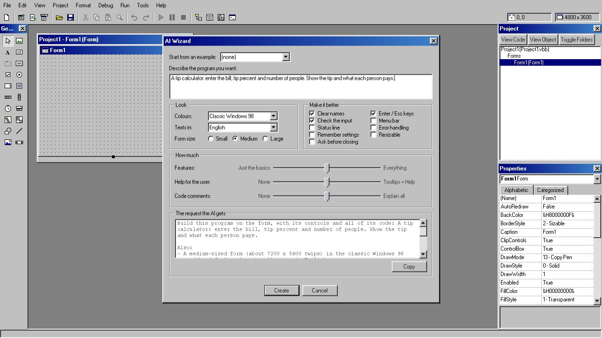

# VibeBasic

A Visual Basic 6 clone for macOS, Windows and Linux, with the authentic Windows 98 look and a built-in AI assistant that runs on your own local model.



## What it does

- **Form designer:** drag controls onto a form, set their properties and double-click to write event code.
- **Menus:** Tools > Menu Editor (Ctrl+E) builds a form's menus as in VB6: `&` access keys, separators, submenus, Checked, Enabled and Visible, Shortcut keys, menu control arrays (`Load mnuMRU(i)` for a recent-files list) and `PopupMenu` for context menus. Each form window draws its own Win98 menu bar under its title bar, on every system (on macOS a program's menus never go into the menu bar at the top of the screen). On macOS a Ctrl shortcut also answers to Cmd, except Cmd+C, X, V, A, Z, W and Q, which stay with the Mac.
- **MDI:** Project > Add MDI Form makes the project's MDI form (the AppWorkspace grey; it holds aligned controls such as a Toolbar, a StatusBar or a PictureBox with Align, and invisible ones). Forms with `MDIChild = True` open inside it as Win98 child windows that move, resize, minimize and maximize within it ("MDIForm1 - [Form2]"); `Arrange`, `ActiveForm`, the Window list menu and merged child menus work as in VB6, and `Dim f As New Form2: f.Show` opens another instance of a form.
- **The VB6 language:** subs, functions, control arrays, `On Error`, `MsgBox`, `InputBox` and the familiar run-time error dialog. It also covers class modules (`Property Get/Let/Set`, `Event`/`RaiseEvent`/`WithEvents`, `Implements`), file I/O (`Open`, `Print #`, `Line Input`, `Get`/`Put`, `Dir`…), `SaveSetting`/`GetSetting`, `TypeOf`, named arguments, `Option Base`/`Compare`, `GoSub`, `#If`, the financial functions, `CreateObject` with ADO, `Scripting.Dictionary` and `FileSystemObject`, and VB6's own number and date rules.
- **Graphics and printing:** `Print`, `Line`, `Circle`, `PSet`, `PaintPicture`, `ScaleMode`, `AutoRedraw` and the `Paint` event on forms and PictureBoxes; the `Printer` object and the `Printers` collection print through a print preview and the system's print dialog (on macOS also Save as PDF).
- **Forms at run time:** `MousePointer` (the hourglass), the `Validate` event with `CausesValidation`, Alt+letter access keys, drag and drop (`DragDrop`/`DragOver`, OLE drag and drop with `DataObject`, and files dropped from Finder or Explorer), `Me.Controls`, `Forms`, `Clipboard` and `Screen`.
- **Code window:** Visual Studio-style colours (or classic VB6), folding of procedures and blocks (Edit > Outlining, Ctrl+M), indentation guides, procedure separators, matching `If`/`End If` highlighting, and automatic `End` lines.
- **Run and debug:** F5 runs the program in real windows. Breakpoints (F9), stepping (F8), the Immediate, Locals, Watch and Call Stack windows, data tips and Set Next Statement work as in VB6. Programs can start in `Sub Main` and read `Command$`.
- **Open VB6 projects:** File > Open Project reads `.vbp` projects with their `.frm`, `.frx`, `.bas` and `.cls` files, and shows a report of anything VibeBasic cannot use.
- **Make app:** File > Make builds a standalone program from your project, with its icon and the version information from Project Properties > Make. On macOS it is an `.app` that also opens the file types you list. On Windows, Make writes a single `<Name>.exe` (the project's icon and version information in its resources; it runs on Windows 10 and 11, which have the WebView2 runtime). File types are not registered there: Open With passes the file to `Command$`. On Linux it writes the `<Name>` executable with a `<Name>.desktop` launcher and `<Name>.png` icon next to it (it needs WebKitGTK 4.1, as VibeBasic does). Make only replaces a program it made itself.
- **Controls:** the classic intrinsic controls, plus ActiveX-style components picked under Project > Components (Ctrl+T):
  - Common Controls: TreeView, ListView, Toolbar, StatusBar, ImageList, ImageCombo, CoolBar (bands host other controls), DTPicker, FlatScrollBar, Animation (GIF, APNG, WebP and MP4 instead of AVI) and others, plus the Access-style Calendar (MSCAL).
  - Media and data: MSFlexGrid, MSChart, RichTextBox, MaskedEdit, MMControl and MediaPlayer.
  - Networking: WebBrowser, Inet and Winsock.
  - Serial ports and system information: MSComm (for an Arduino or a 3D printer over USB) and SysInfo. `CommPort` n opens COMn on Windows (as in VB6), the n-th `/dev/cu.*` device on macOS and the n-th `/dev/ttyUSB*` or `/dev/ttyACM*` device on Linux; the extra property `PortName` takes the port itself, e.g. `MSComm1.PortName = "/dev/cu.usbmodem1101"` or `"COM5"`.
  - Databases: the Data control, the ADO Data Control, DataGrid, DataList and DataCombo, with data binding. They use SQLite files (`.db`) instead of Jet `.mdb` files.
  - Sheridan 3D controls: SSPanel (with the flood bar), SSFrame, SSCommand, SSCheck, SSOption and SSRibbon.
  - Microsoft Agent, with characters of its own.
- **AI assistant:** connects to any OpenAI-compatible server, such as Ollama or vLLM.
  - Ask AI (Ctrl+I) writes code in the code window, or lays out controls in the form designer.
  - **Ask AI** in the error dialog suggests a fix for the line that failed.
  - Every suggestion is shown as a preview. You can refine it with **Change...**, and it is applied as one undo step.
  - With a vision model, the AI sees a picture of your form. A layout check catches overlapping controls and cut-off captions, and the AI places controls relative to each other ("below Text1", "arrange as a row").
  - Generated code is checked before you see it: syntax, event signatures, missing procedures and wrong properties. Problems go back to the model once.
  - Questions get plain answers. Tools > AI Log shows every request, answer, token count and timing.

## Download

Get the files from the [latest release](https://github.com/Stigern/VibeBasic/releases/latest) (X.Y.Z is the version):

| System | File | |
|---|---|---|
| macOS 12 or later, Apple Silicon | `VibeBasic-X.Y.Z-macos-arm64.zip` | Unzip and move VibeBasic.app to Applications. |
| Windows 10 or 11 (x64) | `VibeBasic-X.Y.Z-windows-x64-setup.exe` | The installer: Start menu entry and uninstaller. |
| | `VibeBasic-X.Y.Z-windows-x64.zip` | Portable: `VibeBasic.exe` alone, nothing installed. |
| Linux x64 (Debian, Ubuntu…) | `VibeBasic-X.Y.Z-linux-x64.deb` | `sudo apt install ./VibeBasic-X.Y.Z-linux-x64.deb` installs it with its dependencies. |
| Linux x64 (other distributions) | `VibeBasic-X.Y.Z-linux-x64.AppImage` | `chmod +x` it and run it. |

The apps are not signed by Apple or Microsoft, so the first start needs one extra step:

- **macOS:** right-click VibeBasic.app and choose **Open**, then **Open** again (on macOS 15 or later: try to open it once, then click **Open Anyway** under System Settings > Privacy & Security).
- **Windows:** if SmartScreen says "Windows protected your PC", click **More info**, then **Run anyway**. VibeBasic uses the Microsoft Edge WebView2 runtime, which Windows 10 and 11 have; the installer fetches it when it is missing.
- **Linux:** VibeBasic needs WebKitGTK 4.1 (the .deb pulls it in). The AppImage brings its own, but the programs you make with it use the system's: `sudo apt install libwebkit2gtk-4.1-0` on Debian and Ubuntu, `sudo dnf install webkit2gtk4.1` on Fedora. Debian 12, Ubuntu 22.04 or newer.

## Build

Requires Node.js, Rust and the Tauri 2 prerequisites.

```bash
npm install
npm run tauri dev      # run the IDE
npm run build:app      # build VibeBasic.app (scripts/build-app.sh runs tauri build)
npm test               # run the tests
```

On Windows and Linux, build with `npx tauri build --bundles nsis` or `npx tauri build --bundles deb,appimage` (tauri.conf.json lists only the macOS bundle). The release files are built by GitHub Actions (`.github/workflows/release.yml`) for each version tag; CI (`ci.yml`) runs the type check and the tests on all three systems.

### Code signing (macOS)

The signing identity is not in the repository. To sign your builds, create a file `.env.local` next to `package.json` (it is git-ignored) with your own identity:

```bash
APPLE_SIGNING_IDENTITY="Apple Development: Your Name (TEAMID)"
```

`security find-identity -v -p codesigning` lists the identities on your Mac. `npm run build:app` loads `.env.local`, and the Tauri bundler reads `APPLE_SIGNING_IDENTITY` from the environment. Sign every build with the same identity, or macOS asks again for permissions such as Local Network access (Winsock). Without an identity the app is built unsigned.

## AI setup

Set up the AI under Tools > Options > AI. Enter the server's base URL, for example `http://<host>:11434/v1` for Ollama or `http://<host>:8000/v1` for vLLM, and press Test Connection: it picks the model, and finds out whether the server understands pictures and structured output. A vision model (such as Qwen3-VL or a multimodal Qwen) lets the AI see your forms. Thinking sets how hard a reasoning model thinks; Low is the fastest.

## Status

VibeBasic is a hobby project and a work in progress. See [CHANGELOG.md](CHANGELOG.md) for what is new in each version.

Not supported yet: `Declare` (calling DLLs and system APIs), UserControls, Property Pages and other ActiveX designers, the OLE container, DDE, and some rarely used members of the bigger controls. VibeBasic runs VB6-style code in its own interpreter; it does not run VB6 `.exe` files or real ActiveX `.ocx` files.

The look is inspired by Visual Basic 6 and Windows 98. The UI uses [98.css](https://github.com/jdan/98.css). All icons and Agent characters are original artwork.
